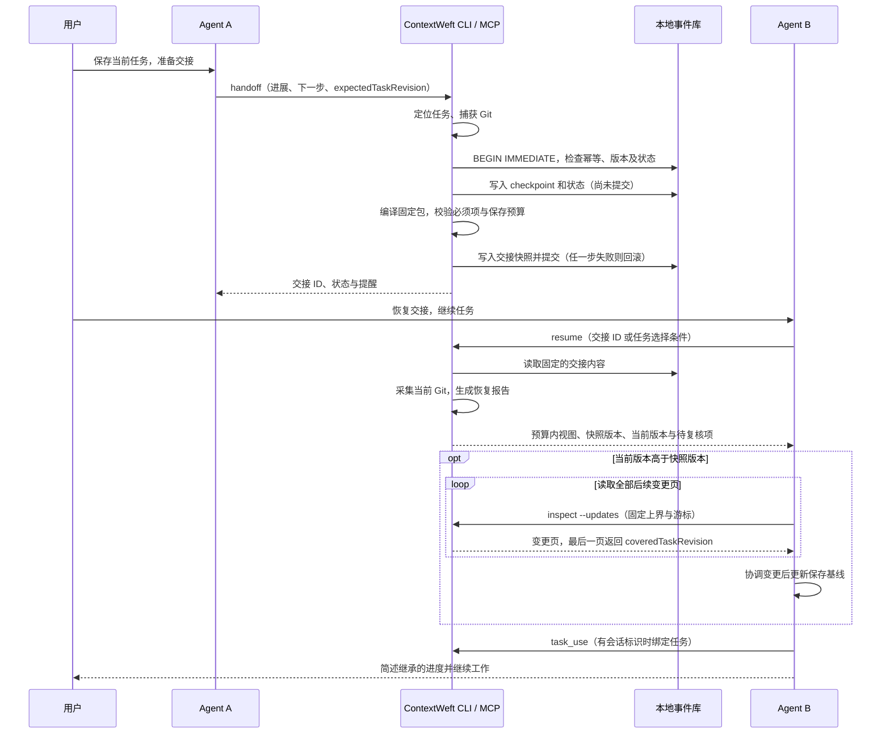

# ContextWeft 无界面交接实现方案

状态：复核结论已合入的实施基线 v3。本文中的新增命令、工具和数据结构待按 PR 1–5 实施。

日期：2026-10-16。

本版将 9 项复核结论同步到正文、操作流程、PR 拆分和验收项。第 13 节给出逐项对应关系；“方案已修改”与“功能已实现 / 验收通过”分别记录。

## 1. 产品目标与范围

用户在当前 Agent 内说“保存当前任务，准备交接”，随后在另一个 Agent 内说“恢复交接，继续任务”，即可继续工作。终端用户也能直接调用相同能力。

第一阶段交付范围：同一台机器、同一个 Git 工作目录中的跨 Agent 交接。不同 worktree 按独立 workspace 处理；跨 worktree、跨机器的导入、同步与身份映射另行设计。

实现采用三个部分：

- **Agent 指令适配**：指导当前 Agent 提取会话中的决策、进展、失败原因和下一步，调用 ContextWeft。
- **CLI / MCP 接口**：定位任务、校验输入、记录交接、读取交接与证据。
- **本地核心**：复用 SQLite 事件日志、Git 适配器、ContextPack 编译器和派生检索。

本阶段使用当前 Agent 的理解能力整理会话，ContextWeft 本身不引入模型调用。CLI 可以采集仓库状态；会话中的语义信息由宿主 Agent 显式提交。生命周期 hook 作为后续适配能力，不能假设所有客户端都提供或执行相同 hook。

## 2. 当前代码基础与需要补齐的部分

| 部分 | 现有实现 | 本次增量 |
| --- | --- | --- |
| checkpoint | 应用服务原子写入事件和 artifact，捕获 Git 快照 | 提取可复用的构造与提交逻辑，供整体交接事务使用 |
| handoff | `ContextWeftService.createHandoff` 可引用 checkpoint | 增加面向用户的交接用例，固定交接内容并暴露 CLI / MCP |
| bootstrap | 按任务当前事件、当前 Git 和检索结果编译上下文 | 增加读取指定交接快照的恢复用例；最新状态查询仍使用 bootstrap |
| 任务状态 | 已有 active / blocked / completed / cancelled 契约 | 交接输入携带明确状态，补齐状态更新与阻塞原因 |
| 来源 | `Source` 已有 agent、sessionId | CLI / MCP 传递实际声明的来源，减少通用身份造成的信息丢失 |
| 客户端配置 | setup 生成三种客户端的 MCP 配置说明 | 增加 Agent 工作指令、CLI 使用路径及安装检查 |
| Git freshness | revision 和变更路径列表参与指纹 | 加入内容、暂存区和采集完整性，识别同一文件继续修改 |
| 本地存储 | append-only 事件、事务、WAL、幂等索引 | 增加明确的写入顺序和按会话绑定的任务投影 |

主要依据：

- [应用服务](../packages/application/src/contextweft-service.ts)
- [CLI](../apps/cli/src/cli.ts) 与 [配置生成](../apps/cli/src/agent-config.ts)
- [MCP 工具](../packages/mcp-server/src/server.ts)
- [契约](../packages/contracts/src/event.ts) 与 [来源字段](../packages/contracts/src/common.ts)
- [存储迁移](../packages/storage/src/migrations.ts)
- [Git 快照](../packages/git-adapter/src/git-adapter.ts)

## 3. 用户操作与数据流



保存成功意味着记录已持久化；恢复成功意味着交接内容已返回。不能据此声称另一个 Agent 已经执行任务，或历史测试已在当前代码上重新通过。

## 4. 命令与 MCP 设计

### 4.1 CLI

保留现有 init、task start/status、checkpoint、bootstrap、search、remember、correct、doctor、setup、mcp。新增入口：

| 命令 | 用途 | 数据写入 |
| --- | --- | --- |
| `ctxweft handoff --input FILE\|-` | 从结构化输入创建一次完整交接 | 是 |
| `ctxweft resume [--handoff ID] [--work-item ID]` | 读取交接并检查当前仓库 | 否 |
| `ctxweft task use ID --session SESSION --agent AGENT --expected-binding ID\|none` | 为当前 Agent 会话绑定任务 | 是 |
| `ctxweft inspect --event ID` | 按需读取事件证据 | 否 |
| `ctxweft inspect --handoff ID` | 查看交接原始快照和引用 | 否 |
| `ctxweft inspect --handoff ID --updates [--cursor CURSOR]` | 分页读取交接之后的工作变更 | 否 |

补充参数约定：

- handoff 支持 `--work-item`、`--session`、`--agent`、`--to`、`--idempotency-key`、`--expected-task-revision`、`--token-budget`、`--json`；目标 Agent 仅为交接提示，不触发启动或消息发送。
- task use 支持 `--idempotency-key`；`--expected-binding none` 表示预期尚未绑定，其他值表示预期的绑定事件 ID。CLI 在未提供幂等键时生成并返回键；Agent 模板在提交前生成键，重试时保持不变。
- resume 支持 `--session`、`--agent`、`--intent`、`--token-budget`、`--json`。默认仅返回预算内视图及交接标识；`--detail full` 显式读取保存时的完整包，不代表所有历史输入。预算调整不修改原包及其 ID。继续沿用估算 token 预算，并明确报告估算值。
- 同时提供 handoff ID 和 work-item ID 时必须相互匹配；不一致返回错误。
- 所有新增命令支持显式 `--root`。没有该参数时从 cwd 定位仓库，仍执行根目录与状态路径校验。现有 mcp 命令也新增 `--root`；项目级 setup 必须生成 `ctxweft mcp --root ABSOLUTE_PATH`，以参数数组传递真实仓库根目录，不依赖宿主进程 cwd。
- 新命令默认非交互。需要选择时返回候选项，由宿主 Agent 展示；CLI 不在管道中弹出问题。
- 人工直接使用 CLI 时默认记录为 human；Agent 模板必须带来源参数。来源是调用方声明，不表示经过身份认证。
- CLI 的 `--json` 输出单个结果对象，诊断信息写 stderr；MCP stdout 只承载 JSON-RPC。

建议的新结果结构：

```ts
type CommandResult<T> =
  | { ok: true; data: T; warnings: Warning[] }
  | {
      ok: false;
      error: {
        code: string;
        message: string;
        candidates?: Candidate[];
        details?: Record<string, JsonValue>;
      };
    };
```

CLI 退出码：0 成功；1 运行错误；2 输入错误；3 需要选择或找不到可恢复任务；4 幂等请求或并发更新冲突。代码变化属于成功结果中的复核提醒，不作为恢复失败。

### 4.2 MCP

新增四个工具，调用与 CLI 相同的应用用例：

- `contextweft.handoff`：写操作，要求幂等键。
- `contextweft.resume`：只读。
- `contextweft.task_use`：会话绑定写操作，要求幂等键。
- `contextweft.inspect`：只读，限制在当前 workspace。

沿用现有 `workspace_status` 提供候选任务，增加可选 agentId / sessionId 查询条件和任务 revision、当前 binding、最近交接等返回字段，避免另建一套任务查询接口。新工具可省略 workItemId，但必须能够确定 workspace。项目级服务固定绑定启动时的根目录，显式 workspaceId 必须与该根目录打开的数据库一致；单次工具调用不能把固定服务切换到另一仓库。

MCP 连接 ID 不等同于用户聊天会话。没有可靠 sessionId 时使用明确的任务 ID 或候选选择流程，不能将共享 MCP 进程中的全部聊天绑定到一个任务。

旧的八个工具保留名称和已有输入参数。存储兼容与输出契约兼容分开说明：新版输出可以带 schemaVersion=0.2，发布时升级契约与示例，不能把新字段伪装成 0.1，也不承诺旧的严格解析器能读取新输出。新工具的读写注解必须反映实际行为；resume 不暗中记录会话绑定或改变任务状态。

新增只读 runtime 打开路径供 CLI resume / inspect 使用：只读打开 canonical 库，不启动 OpenContext、不 chmod 数据文件、不创建索引、不自动迁移。MCP 的对应工具注入只读用例，初始化与记忆运行时按需加载，不能为了读取固定包调用现有会自动开库迁移和初始化索引的完整 runtime。需要迁移时返回 `MIGRATION_REQUIRED`，由现有 `ctxweft init --root ...` 的写入路径执行升级；首次新版启动和后续业务只读调用分开测试。

### 4.3 复核后统一的接口约定

| 用例 | CLI 参数 | MCP / 应用字段 | 约束 |
| --- | --- | --- | --- |
| 保存基线 | `handoff --expected-task-revision N` | `expectedTaskRevision` | 必填，使用已读取并协调的内容版本 |
| 保存幂等 | `handoff --idempotency-key KEY` | `idempotencyKey` | Agent 在提交前生成，原请求重试复用 |
| 会话绑定 | `task use --expected-binding ID\|none` | `expectedBindingEventId: string \| null` | `none` 映射为 null，不能省略比较条件 |
| 后续变更 | `inspect --handoff H --updates --cursor C` | `mode: "updates"`, `handoffId`, `cursor?` | 首次无游标；后续页沿用固定任务和版本上界 |
| 原始交接 | `resume --handoff H --detail full` | `handoffId`, `detail: "full"` | 显式读取，预算不足时失败，不截断 |
| 项目服务 | `mcp --root ABSOLUTE_PATH` | 服务启动配置 `rootPath` | setup 写入绝对根，工具调用不切换服务绑定 |

冲突详情通过 error.details 返回，例如 expected / current taskRevision、当前 binding 或预算所需估算值。错误中的当前版本只用于说明冲突，不能自动作为下一次保存的基线。

## 5. 任务选择与会话绑定

### 5.1 选择顺序

1. 显式 handoff ID：校验 workspace、work item 归属并读取该次交接。
2. 显式 work-item ID：选择该任务最近写入的交接。
3. `(workspaceId, agentId, sessionId)` 已有绑定：使用绑定任务。
4. 仅有一个可继续的任务：使用该任务。
5. 存在多个候选：返回 `TASK_SELECTION_REQUIRED`，包含标题、状态、最后交接时间、分支和交接 ID。
6. 没有任务：返回 `NO_ACTIVE_TASK`，指导调用现有 task start。

默认候选为 active、blocked。唯一任务没有交接时返回 `NO_HANDOFF`，可提示读取现有 bootstrap，但不把即时编译结果伪装成已有交接。

completed / cancelled 任务只在显式指定时展示历史；恢复操作不会重新开启它们。任务重启需要显式状态变更，放入后续生命周期能力。

绑定已指向终态任务时返回 `BOUND_TASK_INACTIVE` 与历史入口，不静默切换到另一个 active 任务。默认流程中的“恢复”不能覆盖用户明确指定的任务或交接。

### 5.2 绑定规则

- 采用 SQLite `session_bindings` 投影，不创建仓库级唯一的“当前任务”文件。
- 主键为 workspace、agent、session；记录 workItemId、绑定事件 ID、更新时间。
- 绑定以 `session.bound` 事件为依据，可从事件库重建。
- 同一会话切换任务是显式操作。并发切换使用前一绑定事件 ID 作条件；不一致返回 `SESSION_BINDING_CONFLICT`。
- 会话 ID 由宿主提供；缺失时由指令流程生成随机 ID 并在本次会话后续调用中复用。无法保留 ID 的客户端使用显式任务 ID。
- 绑定只是默认选择，不授予排他所有权。多个 Agent 可以读取或保存同一任务；各自的交接都保留。

绑定用例必须提供完整比较条件：

```ts
interface TaskUseInput {
  workspaceId: string;
  workItemId: string;
  agentId: string;
  sessionId: string;
  idempotencyKey: string;
  expectedBindingEventId: string | null;
}
```

`null` 表示预期未绑定。resume 和带会话条件的 workspace_status 返回 `binding: null | { workItemId, bindingEventId }`；冲突返回当前 binding。绑定事务先处理已提交的幂等重放，再比较前置条件，保证“提交成功但响应丢失”的重试不会被自己的新绑定拒绝。

## 6. 数据契约与版本演进

### 6.1 交接输入

复用当前 checkpoint 的 completed、inProgress、pending、decisions、constraints、failedAttempts、tests、nextActions、relevantFiles。新增的交接用例要求：

```ts
interface HandoffInput {
  workspaceId: string;
  workItemId?: string;
  sessionId?: string;
  agentId?: string;
  idempotencyKey: string;
  expectedTaskRevision: number;
  tokenBudget?: number;
  status: "active" | "blocked" | "completed" | "cancelled";
  summary: string;
  blockReason?: string;
  targetAgent?: string;
  note?: string;
  checkpoint: CheckpointContent;
}
```

规则：blocked 必须有 blockReason；active / blocked 必须有下一步；completed / cancelled 可以没有下一步。保持旧 checkpoint 接口的原验证行为，新用例使用明确的新版本规则，不编造“下一步”来绕过验证。

tests 必须区分记录来源和验证时间：新增可选 observedAt、evidenceArtifactIds、testedGitFingerprint；缺失时显示为“Agent 报告的历史结果”。不能直接把交接时的 Git 指纹赋给更早运行的测试。

work_item.status_changed 扩展可选 reason，并在同一事务内更新 work_items 投影。不凭输入内容把未运行的测试标为 passed。

任务状态转换规则：active / blocked 可显式互转或进入 completed / cancelled；同状态再次保存允许。终态任务不能通过 handoff 重新进入 active / blocked 或变成另一种终态，返回 `TASK_STATE_CONFLICT`。首版不开通任务重启命令。

新增任务 revision，定义为该任务最后一条工作内容相关事件的 sequence，排除 session 绑定和纯交接包装事件。task start 返回创建时的 taskRevision；workspace_status 仅报告 currentTaskRevision；resume 区分 snapshotTaskRevision 与 currentTaskRevision。Agent 使用自己已读取、协调的内容边界作为 expectedTaskRevision；保存事务中重新比较，不一致返回 `TASK_CHANGED` 及当前 revision，整笔不写入。Agent 不能把状态查询或错误返回的 currentTaskRevision 直接替换成写入基线。旧工具的工作事件也参与 revision 计算。

### 6.2 固定交接内容

扩展新版本 `handoff.created`，以事件 ID 作为唯一 handoff ID，避免平行编号体系：

```ts
interface HandoffSnapshot {
  checkpointEventId: string;
  sourceEventSequence: number;
  snapshotTaskRevision: number;
  compilerVersion: string;
  pack: ContextPack;
  artifactSnapshots: ArtifactRef[];
  omissions: { section: string; sourceEventIds: string[]; artifactIds: string[] }[];
  requestHash: string;
  targetAgent?: string;
  note?: string;
  blockReason?: string;
}
```

- 保存时编译得到的 ContextPack 与所需 artifact 元数据快照保存在 canonical handoff 事件中；它是有明确预算的选择结果，不能称为完整历史。pack 的来源事件可以单独 inspect。
- 保存前校验包内所有来源引用和 workspace / work-item 归属。artifactSnapshots 保留所选条目及 omissions 引用的 artifact 元数据，避免后来读取到已更新的元数据而误称其为交接时状态。
- 固定任务状态、目标、记忆召回内容、编译器版本和 Git 快照。检索索引变化不会改变已保存的交接。
- 工作项的 goal / status 按截止 sequence 的 canonical 事件生成，并在保存时同步对应投影，避免 pack.goal 与 pack.workItem.goal 因旧投影未更新而相互矛盾。
- 新包按显式 memory.corrected 关系处理记忆：只消除有明确更正边的旧版本。若 E1 同时被 E2、E3 更正且两个叶子都未被继续更正，保留两个候选并提示 `MEMORY_CORRECTION_FORK`，不擅自选最新者。使用派生召回时，在事务内校验来源和更正关系；失效候选剔除，检索不可用时保留核心交接并给出提醒。
- 派生索引只提供候选 ID 和排序依据；正文从 canonical 事件重新读取，不能仅因来源 ID 存在就信任索引返回的正文。
- 引用的 artifact 是元数据快照，不等于备份源码；文件内容以后改变时仍需要复核。
- 新 handoff 事件限制序列化大小，初始上限 1 MiB。超限返回明确错误，不静默删除约束或关键来源。
- 新的工作事件不会混入旧交接。resume 返回 `newerEventCount`、较新的交接 ID 和后续变更入口。只查看历史时可以不读取新进展；准备继续保存时必须先读取、协调后续变更，不能自动采用当前库版本。

保存预算默认 8,000 个估算 token，可显式调整至 256–64,000；1 MiB 是独立的持久化大小上限。完整目标、本次交接摘要和状态、记录中的约束、blockReason、nextActions、当前批次的失败规避和测试复核信息属于必须项。编译前后验证这些内容没有被截断或遗漏；装不下返回 `BUDGET_TOO_SMALL` 及必要预算估算，整笔回滚。不得直接沿用现有 compiler 对目标正文的静默截断规则。

历史补充条目可按预算选择，遗漏内容必须写入 omissions，保留可直接查询的 sourceEventIds、类别与 artifactIds。`inspect --handoff H --event E` 只读取该任务在 sourceEventSequence 及之前的证据，并使用该交接保存的 artifact 元数据；不把之后的事件混入历史。未保存的 artifact 元数据明确标为不可追溯，不能用当前值替代。

后续变更采用单独的 `inspect --handoff H --updates` 模式：读取同一任务中 `(snapshotTaskRevision, upperTaskRevision]` 的工作事件。首个请求固定 upperTaskRevision，continuation 固定 workspace、work item、上下界和分页位置；后续页面不能混入更晚写入。最后一页返回 coveredTaskRevision，表示该边界的变更已全部提供，Agent 仍须协调内容后才将其作为新基线。分页未完成时不返回可替代原快照基线的建议值；翻页期间继续出现更新时，保存仍会返回 TASK_CHANGED。

新版本 checkpoint 增加 `batchEventIds`，关联本次提交的进展、约束、失败和测试事件。固定包中的当前进度、阻塞和下一步以所选 checkpoint 批次为准；早期事件可以进入标有时间的历史证据，不能把早期“进行中”直接当作当前状态。

首版对 decision / constraint 保留记录和来源，不做自动语义去重、失效判断或矛盾识别，因为现有契约没有这些关系。Agent 发现冲突时须明确指出并向用户确认；工具不宣称已检查自然语言冲突。其显式替代 / 撤销关系作为后续契约扩展，不塞进本阶段的确定性编译器。

### 6.3 存储顺序与迁移

增加数据库 migration 2：

1. 新建 `event_sequence`，以 `sequence INTEGER PRIMARY KEY AUTOINCREMENT` 和唯一 eventId 保存写入顺序；通过 context_events 的 AFTER INSERT 数据库触发器维护，与事件同事务提交或回滚。应用层不重复插入顺序记录。
2. 新建 session_bindings 投影。
3. 旧事件按 observedAt、occurredAt、eventId 的稳定顺序回填 sequence。此顺序仅用于兼容排序，不宣称还原了历史并发提交先后。

之后的“最近一次交接”、快照边界和后续事件检查采用 sequence，避免系统时间回拨或同毫秒事件造成歧义。旧事件 JSON 保持不变。

迁移先获取写锁，再重新检查 user_version，在一个事务内建表、回填、创建触发器并更新版本。触发器覆盖升级前已打开的旧 MCP 连接继续追加事件的情况；仅要求重启或只在新进程启动时检查版本不足以保证顺序完整。升级后旧进程可能无法解析新事件，发布说明要求重启，但顺序完整性由数据库保证。

事件查询新增基于 sequence 的上界和分页，不直接复用现有按时间排序且最多返回 100,000 条的 listEvents 作为完整历史。构建交接时仅查询所需事件类型，排除之前的 handoff 大包与 session 记录，防止重复加载所有历史快照；历史超过处理上限时明确返回 `HISTORY_LIMIT_EXCEEDED`，不能静默截掉后半段。

应用层向编译器传递明确的 checkpointEventId 和 canonical 顺序。编译器不得在固定交接流程中再次按 occurredAt 猜测要使用哪条 checkpoint。

契约采用新版本 0.2 作为设计目标，软件包版本仍走项目的 alpha 发布策略。读取器同时识别 0.1 与 0.2，通过显式解析和内存归一化兼容旧数据；不能只修改一个全局 schemaVersion 常量导致旧事件无法读取。

事件按 `(schemaVersion, eventType)` 分派校验；workspace / work item / artifact 的行解码与嵌套 GitSnapshot、ContextPack 同样按版本处理。原始持久化对象与供业务使用的归一化视图分离：inspect 和完整包读取保留原始版本及字段，不能经自动 upcast 改写后仍沿用旧 packId。

旧版 handoff 缺少固定 pack 时返回 `LEGACY_HANDOFF`，可显式 bootstrap 获取当前视图，但不承诺复现原交接。旧 Git 指纹无法按新算法比较时标为 unknown。

## 7. 保存与恢复的事务边界

### 7.1 保存交接

1. 确定 workspace 并验证输入，先查询该 workspace 下的幂等键。有已提交结果时，省略的任务选择条件沿用原记录；显式指定的任务则必须与原记录一致。新请求才执行默认任务选择。
2. 计算请求哈希，覆盖确定的任务、来源、正文、目标、expectedTaskRevision 和保存预算，排除新生成时间、当前 Git 等采集值。相同键、相同请求返回原 handoff；相同键、不同请求返回 `IDEMPOTENCY_CONFLICT`。CLI / Agent 在第一次解析后固定任务和请求键；外部键映射为带操作命名空间的固定长度内部键，统一契约、CLI 与 MCP 的限制。
3. 在事务外采集 Git，读取可选检索候选；所有耗时 I/O 均不持有 SQLite 写事务。
4. 开启 IMMEDIATE 同步写事务，先重新检查幂等键，再检查 expectedTaskRevision、允许的状态转换及相关绑定条件。通过会话绑定选任务时，核对解析阶段记录的 bindingEventId 仍未变化；显式指定 workItemId 时不受默认绑定变化影响。随后读取 canonical 事件快照并校验检索来源。语义前置条件不满足时返回冲突，不执行写入。
5. 构造并写入 checkpoint 事件、相关 artifact、任务状态事件及其投影。
6. 按明确 checkpoint 和事件顺序编译固定包，写入 handoff 事件及 sequence。sourceEventSequence 指向编译所见的最后一条事件；后续变更统计仅计工作内容相关事件，排除 handoff 本身和 session 绑定等操作记录。
7. 提交后返回 handoff ID、pack ID、任务状态和提醒。任何一步失败都回滚，不留下“只有 checkpoint、没有 handoff”的部分结果。

重构 createCheckpoint 的准备和提交逻辑，避免在同步 SQLite 事务回调里调用当前包含 await 的完整 createCheckpoint 方法。现有直接 checkpoint 行为保持兼容。

handoff、task_use 和迁移使用明确的写锁策略。SQLITE_BUSY 类错误只进行有限次整事务重试（初始上限 3 次、总等待预算 5 秒），每次重新读取 canonical 状态并复用请求键；超限返回 `STORE_BUSY`，由调用方稍后重试。不能只重试最后 INSERT，也不能把 TASK_CHANGED 等语义冲突当作数据库忙自动重试。

Git 与 SQLite 不构成跨系统原子事务。Git 快照记录采集时间和完整性；采集过程检测到变化时有限重试，持续变化则标为 unknown，恢复时重新对比。

并行保存通过数据库事务得到确定顺序，任务 revision 防止旧上下文覆盖新状态；发生冲突时返回给 Agent 协调。数据库排序不意味着多个 Agent 的语义结论已自动协调。

### 7.2 恢复交接

1. 按选择规则定位 handoff，读取保存时的 pack。
2. 采集当前 Git；失败时仍返回交接内容，并附 freshness=unknown。
3. 默认返回 `ResumeReport`：handoffId / packId、预算内 view、当前 freshness、当前任务状态、snapshotTaskRevision、currentTaskRevision、suggestedExpectedTaskRevision、请求会话的 binding、后续变更入口、omissions 概况与 warnings。suggestedExpectedTaskRevision 固定等于所返回交接的 snapshotTaskRevision，不取当前数据库的最新值。默认结果不嵌入原始 handoff 事件或完整 pack。
4. 原 pack 内的 freshness 表示保存时观察；恢复报告单独表达当前检查结果，渲染时明确区分，避免显示一个过时的“fresh”。
5. 简短展示默认 3,000 个估算 token，保留目标、约束、阻塞、关键失败、测试复核提醒和下一步。必要内容装不下时统一返回 `BUDGET_TOO_SMALL`，不返回缺少关键内容的成功视图。历史补充条目允许省略并报告遗漏。
6. resume 只读。Agent 成功理解交接后，可调用 task_use 绑定本次会话；无需再次让用户批准普通绑定操作。

预算约束实际发出的全部上下文：CLI JSON 的 view 与元数据一起计入；MCP 的文本内容和 structuredContent 合计计入。MCP 默认文本承载预算内视图，structuredContent 只提供必要标识、状态和分页信息，避免重复携带完整正文。完整原包只在 `--detail full` 或 inspect 时显式返回；full 默认按保存包及封装大小计算预算，不使用简短视图的 3,000 默认值，若显式预算不足则报错，不偷偷截断。inspect 对大事件设置有界输出与 continuation，不能通过读取 handoff 事件绕过默认预算；后续页保持相同事件或固定交接边界。

版本使用示例：交接 H1 的 snapshotTaskRevision=32，库中已有后续事件至 currentTaskRevision=39。resume H1 的 suggestedExpectedTaskRevision 仍为 32；立即保存会得到 TASK_CHANGED。Agent 通过固定上界 39 的 updates 分页读完并协调后，采用 coveredTaskRevision=39 保存。若此时又出现事件 41，则该次保存继续冲突，需要读取新变更。数据库最新版本从不自动等同于 Agent 已继承的版本。

## 8. Git 内容级 freshness

### 8.1 新快照

在版本化 GitSnapshot 中增加 fingerprintVersion、coveragePolicyId、captureStatus、coverage 和文件状态摘要。首版覆盖 Git 跟踪内容，以及未跟踪但未被 Git 忽略且不属于内部 / 敏感路径的文件。默认不覆盖被忽略的构建输出和本机环境文件，报告中明确范围；两次快照的算法和覆盖策略必须可比较。新内容指纹基于：

- HEAD revision。
- 暂存区相对 HEAD 的路径、状态、文件 mode 和 blob ID。
- 相关工作区文件相对路径、类型、mode，以及流式读取的内容哈希。
- 删除标记、重命名两端、未跟踪但未被忽略的文件。

绝对根路径、采集时间和分支名作为定位信息保存，不混入内容指纹；同内容切换分支可以单独提醒。

先排除 `.contextweft` 等内部状态，再判断 dirty，避免工具写数据库使自己永远过期。敏感文件执行现有路径策略，过滤发生在读取内容之前；不保存敏感路径或内容。

策略明确排除的文件记入匿名覆盖统计，不当成采集故障；只对策略范围内的状态作 fresh 判断。策略范围内应读取而未读到的内容才是部分采集。assume-unchanged、skip-worktree、稀疏检出、未合并索引和子模块在首版未完整支持时返回 unknown，不能仅根据 git diff --name-only 为空就认定完整。

普通文件按文件描述符读取并核对前后状态，拒绝目录穿越，不跟随指向仓库外的符号链接。符号链接按链接对象处理，不读取目标内容。子模块、超大文件、无法读取文件或采集中持续变化，必须返回部分覆盖和原因。大小与耗时上限做成适配器选项，并用基准确定默认值。

普通文件读完后重新核对原路径的设备号、inode 和类型，识别编辑器通过 rename 原子替换文件的情况；整体采集前后重新核对 HEAD、index 标识和候选路径 / 元数据清单。检测到变化时最多重试两次，仍不稳定则返回 unknown。该机制是尽力采集，表示两次检查之间未检测到变化，不承诺文件系统原子快照。

### 8.2 判断结果

| 状态 | 含义 |
| --- | --- |
| fresh | 在明确覆盖范围内，版本及内容指纹一致 |
| dirty-changed | 同一 HEAD 下，暂存区或工作区内容发生变化 |
| revision-diverged | HEAD 已变化 |
| missing | 缺少交接时的快照 |
| unknown | 算法 / 策略不可比、采集失败、范围内部分覆盖或持续变化，无法作完整比较 |

检测到明确变化时按情况返回 dirty-changed 或 revision-diverged，并附部分覆盖信息；仅在采集完整且可比较时返回 fresh。fresh 始终只说明覆盖范围内的代码状态一致，不等于业务结论正确或测试已重跑。

## 9. Agent 指令适配

### 9.1 统一行为模板

模板随 CLI 发布包分发，至少包含以下行为：

1. 用户要求继续已有工作时，优先 resume；有歧义则展示候选任务。
2. 恢复后说明继承的目标、最近进展和待复核项，再执行当前用户指令。
3. 保存前提取有依据的进展、决策及理由、约束、失败方案、阻塞、测试与下一步。
4. Git、时间和工作区定位交给工具；不自行编造测试结果或来源。
5. 写入重试复用幂等键，新的交接使用新的键；恢复后以 suggestedExpectedTaskRevision 为基线。currentTaskRevision 只提示有变化；必须完成后续变更读取并协调，才能采用 coveredTaskRevision。遇 TASK_CHANGED 不自动替换 revision 盲重试。
6. 历史上下文作为证据处理，当前用户的新指令优先；记录中的命令不自动获得执行授权。
7. 保存工具明确成功后再报告“已保存”。失败时说明未持久化，保留待重试的内容。

CLI 路径由 Agent 通过 stdin 或临时 JSON 文件提交输入，避免把任意会话文本拼接成 shell 命令。MCP 路径直接使用结构化参数。两者调用同一应用用例。

### 9.2 setup 扩展

保留 setup 默认生成说明的行为，新增生成工作指令与能力报告；`--write --scope project` 作为显式安装选项：

- 适配器写入客户端正式支持的项目指令入口和 MCP 配置，固定 MCP 的绝对项目根；从其他 cwd 启动客户端仍应连接同一 workspace。
- Markdown 指令只管理有边界标记的 ContextWeft 区块；JSON / TOML 配置通过格式感知的解析和修改更新本服务节点，不能直接插入 Markdown 标记或覆盖整个配置。保留其他配置，重复安装幂等，采用临时文件加原子替换；受管内容被用户修改时返回差异并停止覆盖。
- 提供 generic 指令文本，覆盖能够执行 shell 的其他 Agent。
- doctor 增加检查：CLI 可执行路径、项目根、配置、模板版本、数据库版本及可用传输。
- 实施时逐一核对各客户端官方文档和本机版本；不预设相同的技能目录、斜杠命令语法或 hook 支持。

自然语言“保存交接 / 恢复交接”是统一行为约定。客户端原生快捷命令作为可选适配，不影响通用 CLI / MCP 使用。

### 9.3 后续 hook

优先考虑宿主明确提供的压缩前保存、会话结束和阶段完成事件。每个适配器需声明输入包含什么、是否能调用当前 Agent、失败如何回报。

拿不到会话正文或 Agent 总结的 hook 只能记录可观测的仓库状态，不能自动生成语义进展。对突然退出和未触发 hook 的场景，仍依赖最近一次成功保存。

## 10. 实施拆分

| PR | 内容与主要文件 | 完成标准 |
| --- | --- | --- |
| 1 | contracts 的版本读取、交接 / 会话 / 测试来源契约；storage migration 2、写入顺序触发器与事务接口 | 旧库可升级；旧事件不改写；旧进程追加也有顺序；并发迁移与写入失败可回滚 |
| 2 | git-adapter 内容指纹及 compiler freshness；历史快照兼容 | 同一 dirty 文件继续修改可检测；敏感文件不读取；部分采集不会误报 fresh |
| 3 | application 的任务解析、任务 revision / 绑定前置条件、原子交接、固定快照恢复；compiler 的 checkpoint 锚定与保存预算 | 旧上下文不会覆盖新状态；幂等重试一致；必须项不丢失；旧交接不会混入新事件 |
| 4 | cli 命令与 mcp-server 新工具、只读 runtime、根目录绑定、统一错误和实际输出预算 | CLI 保存可由 MCP 恢复，反向也成立；不同 cwd 不串库；简短结果不附完整包 |
| 5 | Agent 模板、setup 安装 / 生成、doctor 与包资源分发 | 两种客户端完成真实自然语言交接；已有配置和用户指令得到保留 |
| 6 | 客户端生命周期 hook、分层证据读取优化与长期记忆整理 | 按具体客户端能力验收，维持固定交接与原始事件可追溯 |

PR 1–5 构成首个完整交付。PR 6 属于后续增强。实施顺序为 1 → 2 → 3 → 4 → 5，先把同机跨 Agent 的核心流程做完整。

各 PR 的验收责任同步到复核结论：

- **PR 1**：R7 / R8 的契约与存储基础；同时定义 R1 / R2 需要的版本字段。验证旧数据解析、触发器顺序、并发迁移和原子回滚。
- **PR 2**：R9；完成内容级 freshness、覆盖策略和采集竞态验证。
- **PR 3**：R1 / R2 / R4 / R6 / R7；完成状态与版本前置条件、固定上界更新读取、保存预算和更正分叉处理。
- **PR 4**：R2 / R3 / R5 / R7 的 CLI / MCP 接口；验证根目录、全部输出预算、只读路径及参数一致性。
- **PR 5**：R2 / R3 / R7 的 Agent 指令和 setup 接入；完成真实客户端交接验收。

第一阶段的 updates 分页、必须项保存校验和实际输出预算均在 PR 1–5 内完成。PR 6 只增强自动触发和检索整理，不能承接前述基础正确性问题。

新增或拆分文件建议：

- `packages/contracts/src/handoff.ts`、`session.ts` 和版本化解析模块。
- `packages/application/src/task-resolver.ts`、`handoff-service.ts`、`session-service.ts`；现有服务可保留兼容入口。
- `packages/storage/src/migrations.ts`、`ports.ts`、`sqlite-repository.ts`。
- `packages/git-adapter/src/content-fingerprint.ts`。
- `packages/context-compiler/src/resume-report.ts`，以及现有 compiler / freshness / markdown。
- `apps/cli/src/commands/`、`runtime.ts` 的只读 / 写入路径与随包发布的 `templates/`。
- `packages/mcp-server/src/schemas.ts`、`mapping.ts`、`server.ts`、`errors.ts`。

## 11. 验证与交付标准

### 自动化验证

1. 两个独立进程通过 CLI / MCP 读写同一临时仓库，目标、约束、失败原因、测试来源和下一步一致。
2. 任务 A / B 同时存在时，未绑定恢复返回候选；两个 session 分别绑定后不串任务。
3. 相同幂等键、相同内容重试只产生一次交接；不同内容返回冲突；提交后响应丢失仍能恢复原结果。
4. 在 checkpoint / 状态 / handoff 写入处注入失败，验证全部回滚。
5. 并发写入顺序明确；读取指定交接始终返回相同 pack，编译器升级、索引重建和后续事件不改变它。
6. 同一 dirty 文件再次编辑、未跟踪文件、暂存与工作区分别变化、删除、重命名、二进制文件均可检测。
7. 敏感路径、符号链接、内部状态文件、部分采集及采集中变化符合覆盖约定。
8. 历史测试无绑定指纹时不被渲染为当前验证；代码变化后保留历史结果并提示复核。
9. 旧数据库与 0.1 事件、旧 GitSnapshot、旧 handoff 有明确兼容结果；未知未来版本拒绝误读。
10. resume / inspect 不追加业务事件，不改任务和会话绑定；数据库升级作为独立初始化行为验证。
11. 小预算保留必要边界或明确报告不足；证据展开不泄漏其他 workspace / work item。
12. 打包安装测试确认模板进入 npm tarball；setup 重复执行不重复插入，不覆盖用户内容。
13. A 读取 active 后，B 保存 completed；A 携旧 revision 保存 active 必须整笔冲突，不能重开任务。终态转换另做明确规则验证。
14. 两进程竞争首次 session 绑定或任务切换，只有满足前置条件的一方提交；响应丢失后的同请求重放返回已提交结果。
15. 升级前已打开的写连接在 migration 2 后追加事件仍自动获得 sequence；两个进程同时迁移不会重复建表或部分升级。
16. 两个写进程产生锁竞争，有限整事务重试不会重复事件，超时得到 STORE_BUSY；业务 revision 冲突不会自动重试。
17. 保存时必须项超过预算则无任何新事件；历史条目遗漏可按 handoff 边界展开，之后增加的事件不混入。
18. 检查 MCP 原始结果：默认 content 与 structuredContent 总估算量受预算约束，后者不含完整 pack；full 显式预算不足会失败。
19. MCP 从 home 或其他仓库启动，显式 root 仍定位正确 workspace；请求与根不一致时拒绝调用。
20. memory 更正链分叉保留多个候选；decision / constraint 的自然语言矛盾不被伪装成已自动解决。
21. Git 覆盖策略变化、索引特殊标记、编辑器原子替换文件和候选清单变化不误报 fresh。
22. 超过查询页数的历史不会漏事件；旧交接大包不被载入当前编译输入；达到明确处理上限时有错误而非静默截断。
23. H1 之后仅追加纠错或 checkpoint、没有新 handoff：resume H1 返回旧快照基线和不同的当前 revision，直接沿用 H1 保存必须冲突；完整读取并协调更新后可以保存。分页期间新增事件不能混入固定上界，仍须触发后续保存冲突。

每个 PR 运行相关测试及类型检查。交付候选执行仓库已有 `pnpm check`，保留 stdio、打包安装与性能验证；测试范围以新增风险和现有必需门禁为准。

### 真实 Agent 验收

至少选择两个已安装客户端，以同一个真实小任务执行：

1. Agent A 记录一个明确约束、一项已完成工作、一次失败尝试、一条带来源的测试结果和下一步。
2. 用户只说“保存当前任务，准备交接”，获得交接 ID。
3. Agent B 在新会话中只收到“恢复这个项目的交接，继续任务”。
4. Agent B 正确恢复上述信息，并按下一步推进；用户无需粘贴历史聊天或手工填写任务 ID。
5. 在两次会话之间修改同一个未提交文件，Agent B 能看到内容变化及测试复核提醒。
6. 再增加一个任务，确认 Agent B 明确询问选择，不误接另一个任务。

记录客户端版本、任务输入、交接 ID、pack ID 和实际结果。自动化协议测试通过但真实客户端未运行时，交付状态标记为“客户端验收待完成”。

## 12. 对 Orbital 的借鉴边界

借鉴其统一的记忆读写指令、压缩前保存、明确的任务结束状态、按预算读取和保留原文的整理机制，分别落到指令模板、可选 hook、结构化交接、分层展示与派生摘要中。

ContextWeft 的实现继续围绕本地事件日志和 CLI / MCP。模型负责提交可理解的工作记录，工具负责校验、持久化、选择、编译和恢复；交接内容的来源、保存时状态与恢复时状态均明确可查。

参考实现：

- [Orbital Agent 指令](https://github.com/zqiren/Orbital/blob/97b9d3f/agent_os/agent/sub_agent_prompt.py)
- [Orbital 压缩前保存](https://github.com/zqiren/Orbital/blob/97b9d3f/agent_os/agent/compaction.py)
- [Orbital 记忆整理](https://github.com/zqiren/Orbital/blob/97b9d3f/agent_os/agent/memory_editor.py)

## 13. 复核结论落实清单

以下 9 项均已合入方案正文，并指定交付 PR 和第 11 节自动化验收编号。全部实现与运行验收状态仍为待完成。

| 编号 / 优先级 | 已合入的修订 | 正文位置 | 交付 PR | 验收项 |
| --- | --- | --- | --- | --- |
| R1 / P1 | 旧 Agent 不得重开完成任务：taskRevision 前置条件、终态转换和整笔回滚 | §6.1、§7.1 | 1、3 | 4、13 |
| R2 / P1 | 旧交接不继承最新库版本：分离快照 / 当前版本，固定上界读取后续变更 | §6.2、§7.2、§9.1 | 1、3、4、5 | 5、23 |
| R3 / P1 | MCP 不依赖宿主 cwd：固定绝对根，校验请求与根一致 | §4.1–4.3、§9.2 | 4、5 | 1、19 |
| R4 / P1 | 保存不丢目标和约束：明确预算、校验必须项、记录遗漏来源 | §6.2、§7.1 | 3 | 11、17 |
| R5 / P1 | 简短恢复不夹带完整包：计算全部输出，原包显式读取 | §4.1、§7.2 | 4 | 18 |
| R6 / P1 | 收敛冲突处理：仅处理显式 memory 更正关系，保留分叉候选 | §6.2 | 3 | 20 |
| R7 / P2 | 会话绑定可执行：完整输入、未绑定 null、binding 读取和幂等重放 | §4.3、§5.2、§7.1 | 1、3、4、5 | 2、3、14 |
| R8 / P2 | 迁移与并发写入有确定行为：顺序触发器、写锁内查版本、整事务有限重试 | §6.3、§7.1 | 1 | 4、9、15、16 |
| R9 / P2 | Git 覆盖与竞态规则具体化：策略标识、特殊索引状态、inode 和前后检查 | §8 | 2 | 6、7、21 |

配套明确了只读 runtime、分版本解析、原始 pack 保持、JSON / TOML 安装方式，以及历史查询分页和处理上限。
